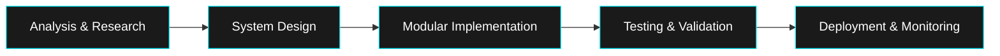
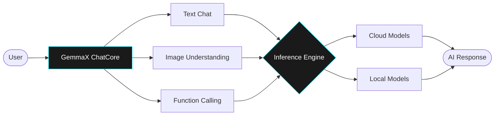

  

  

  <a href="https://jibitesh-portfolio.vercel.app/" target="_blank" aria-label="Portfolio">
    
  

  

  
  
  
  

  

---

## PROFESSIONAL_SUMMARY

> **STATEMENT**: Computer Science undergraduate with interests in **Software Engineering**, **Artificial Intelligence**, and **Aerospace Technology**. Passionate about designing reliable software, understanding intelligent systems, and applying engineering principles to real-world challenges.

### TECHNICAL_OBJECTIVES

- **Algorithms & Problem Solving:** Strengthening foundations in Data Structures, Algorithms, and complexity analysis through consistent practice.
- **Artificial Intelligence:** Exploring machine learning, generative AI, multimodal systems, and real-world AI applications.
- **Software Engineering:** Building reliable, maintainable software while learning system design, clean architecture, and engineering best practices.

---

## ENGINEERING_METHODOLOGY (SDLC)

Standardized approach to software development, ensuring rigorous quality control and maintainability.

---

## TECHNICAL_STACK_&_INSTRUMENTATION

<table width="100%">
  <tr>
    <td width="50%" valign="top">
      <h3>CORE_LANGUAGES</h3>
      
      
    </td>
    <td width="50%" valign="top">
      <h3>AI_&_ML</h3>
      
      
      
      
    </td>
  </tr>
  <tr>
    <td width="50%" valign="top">
<h3>CS_FUNDAMENTALS</h3>

    </td>
    <td width="50%" valign="top">
    <h3>TOOLS</h3>

  

    </td>
  </tr>
</table>

---

## FEATURED_PROJECT: GemmaX ChatCore

**Multimodal Framework for Advanced AI Inference & Experimentation**

### Technical Implementation Details

- **Hybrid Inference:** Supports both cloud-hosted and local model execution through a unified workflow.
- **Multimodal Interaction:** Processes text prompts and image inputs within a single conversational interface.
- **Conversation Memory:** Maintains chat history to enable context-aware multi-turn interactions.

**TECHNOLOGIES:** `Python` `Gemma` `JAX` `Keras Hub` `Google GenAI API`

[**Source Repository →**](https://github.com/jibitesh-auth/GemmaX_ChatCore)

---

  <h3>CONTRIBUTION_TIMELINE</h3>
  <picture>
    <source media="(prefers-color-scheme: dark)" srcset="https://raw.githubusercontent.com/jibitesh-auth/jibitesh-auth/output/github-contribution-grid-snake-dark.svg" />
    <source media="(prefers-color-scheme: light)" srcset="https://raw.githubusercontent.com/jibitesh-auth/jibitesh-auth/output/github-contribution-grid-snake.svg" />
    
  </picture>

---

  <i>
    "When you look at the stars and the galaxy, you feel that you are not just from any particular piece of land, but from the solar system."
  </i>
   
  — Kalpana Chawla

  

FOLIO-0B3D91?style=for-the-badge&logo=googlechrome&logoColor=white" alt="Portfolio Badge" />
  </a>
  
  
  

  
  

---

## PROFESSIONAL_SUMMARY

> **STATEMENT**: Computer Science undergraduate specializing in **Software Engineering**, **Artificial Intelligence**, and **Aerospace Technology**. Focused on architecting reliable software systems, engineering high-performance intelligent pipelines, and applying rigorous computational principles to complex real-world challenges.

### TECHNICAL_OBJECTIVES

- **Algorithms & Problem Solving:** Engineering optimal solutions using advanced Data Structures, Algorithmic paradigms, and rigorous time-space complexity analysis.
- **Artificial Intelligence:** Architecting multimodal AI systems, hybrid local/cloud LLM inference pipelines, and deterministic tool-calling workflows.
- **Software Engineering:** Designing modular, maintainable software systems built on clean architecture, concurrency principles, and production-grade engineering standards.

---

## ENGINEERING_METHODOLOGY (SDLC)

Standardized systems engineering workflow, ensuring rigorous quality control, low-latency performance, and long-term maintainability.

   ➔
   ➔
   ➔
   ➔
  

---

## TECHNICAL_STACK_&_INSTRUMENTATION

<table width="100%">
  <tr>
    <td width="50%" valign="top">
      <h3>CORE_LANGUAGES</h3>
      

        
        
      

    </td>
    <td width="50%" valign="top">
      <h3>AI_&_ML</h3>
      

        
        
        
        
        
        
        
      

    </td>
  </tr>
  <tr>
    <td width="50%" valign="top">
      <h3>CS_FUNDAMENTALS</h3>
      

        
        
        
        
      

    </td>
    <td width="50%" valign="top">
      <h3>TOOLS</h3>
      

        
        
        
      

    </td>
  </tr>
</table>

---

## FEATURED_PROJECT: GemmaX ChatCore

**Multimodal Framework for Advanced AI Inference & Experimentation**

<table width="100%">
  <tr align="center">
    <td>
       
      Prompt / Media
    </td>
    <td><b>➔</b></td>
    <td>
       
      Core Router
    </td>
    <td><b>➔</b></td>
    <td>
       
       
      
    </td>
    <td><b>➔</b></td>
    <td>
       
      Hybrid Dispatch
    </td>
    <td><b>➔</b></td>
    <td>
       
      
    </td>
    <td><b>➔</b></td>
    <td>
       
      Structured Output
    </td>
  </tr>
</table>

### Technical Implementation Details

- **Hybrid Execution Engine:** Unifies hardware-accelerated local model inference (`JAX` / `Keras Hub`) with cloud-scale execution (`Google GenAI API`) through a single routing abstraction.
- **Multimodal & Tool Calling:** Processes simultaneous text prompts and visual inputs alongside deterministic function-calling pipelines within a unified interface.
- **Stateful Context Management:** Maintains structured multi-turn conversation memory for context-aware reasoning and experimentation.

**TECHNOLOGIES:** `Python` `Gemma` `JAX` `Keras Hub` `Google GenAI API`

[**Source Repository →**](https://github.com/jibitesh-auth/GemmaX_ChatCore)

---

  <h3>CONTRIBUTION_TIMELINE</h3>
  <picture>
    <source media="(prefers-color-scheme: dark)" srcset="https://raw.githubusercontent.com/jibitesh-auth/jibitesh-auth/output/github-contribution-grid-snake-dark.svg" />
    <source media="(prefers-color-scheme: light)" srcset="https://raw.githubusercontent.com/jibitesh-auth/jibitesh-auth/output/github-contribution-grid-snake.svg" />
    
  </picture>

---

  <i>
    "When you look at the stars and the galaxy, you feel that you are not just from any particular piece of land, but from the solar system."
  </i>
   
  — Kalpana Chawla

  

